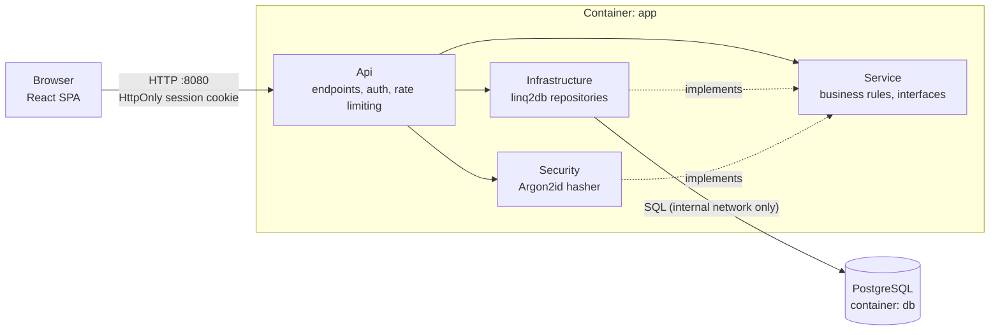
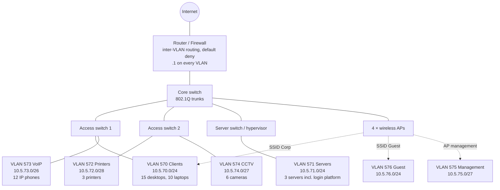

# Compulsory assignment: Kvist & Bjælke ApS – Secure Login Platform & Infrastructure

> **CDS Security & Infrastructure, CSe2025, 3rd semester (SEA - Syddansk Erhvervsakademi)**
>
> **Group:** Davide Jorge · Lucas Santos

> ⚠️ **Before submitting: search this file for `TODO` and replace every placeholder with real content, screenshots and real outputs.**

---

## Table of contents

- [Part 1 – CDS.security](#part-1--cdssecurity)
  - [1. Description of the login platform](#1-description-of-the-login-platform)
  - [2. Implemented security features](#2-implemented-security-features)
  - [3. Alternatives considered](#3-alternatives-considered)
  - [4. Source code and how to run](#4-source-code-and-how-to-run)
- [Part 2 – CDS.infrastructure](#part-2--cdsinfrastructure)
  - [1. IP addressing plan](#1-ip-addressing-plan)
  - [2. Subnetting](#2-subnetting)
  - [3. Network diagram](#3-network-diagram)
  - [4. Ubuntu Server on VLAN 571](#4-ubuntu-server-on-vlan-571)
  - [5. Docker installation and deployment](#5-docker-installation-and-deployment)
  - [6. Client machine on VLAN 570](#6-client-machine-on-vlan-570)
  - [7. Client ↔ login platform communication](#7-client--login-platform-communication)
  - [8. Challenges and solutions](#8-challenges-and-solutions)
  - [9. VLANs, routing and firewall explained](#9-vlans-routing-and-firewall-explained)
- [Final reflection](#final-reflection)

---

# Part 1 – CDS.security

## 1. Description of the login platform

The platform is a web application where users authenticate with a **username and password** and, once logged in, see a user table whose available actions depend on the user's **role**.

| Role | Permissions |
|---|---|
| `user` | Read the list of users |
| `superuser` | Create, read, update and delete **users** |
| `admin` | Create, read, update and delete **users, superusers and admins** |

**Assumptions we made where the assignment is open:**
- All authenticated roles may *read* the full user list (the `user` role exists to read "users in a table").
- A `superuser` can only manage accounts with role `user`, and can never promote anyone to `superuser` or `admin`.
- There is no self-registration; the first admin is seeded from an environment variable.

### Technology stack

| Layer | Choice |
|---|---|
| Backend | .NET 10 (C#), ASP.NET Core minimal APIs |
| Data access | linq2db + Npgsql, PostgreSQL 17 (production) |
| API docs | OpenAPI + Swagger UI (Development only) |
| Password hashing | **Argon2id** (`Konscious.Security.Cryptography.Argon2`) |
| Frontend | Bun, React, React Router, Tailwind + daisyUI |
| Packaging | Multi-stage Dockerfile, Docker Compose |
| IDE | JetBrains Rider |

### Architecture



**Dependency direction:** `Service` has no dependency on any other project. `Infrastructure` and `Security` implement interfaces *defined in* `Service`, and `Api` wires everything together via dependency injection. This keeps the authorization rules testable without a database or a web server, and lets us replace the hashing algorithm or database without touching the business logic.

The React app is built by Bun and served as static files by ASP.NET Core, so the whole solution is **one container on one port** (no CORS configuration needed).

### Screenshots

| Login | User table (role: user) |
|---|---|
| `TODO: docs/img/login.png` | `TODO: docs/img/users-as-user.png` |

| User table (role: superuser) | User table (role: admin) |
|---|---|
| `TODO: docs/img/users-as-superuser.png` | `TODO: docs/img/users-as-admin.png` |

| Swagger UI (dev) | Hashes in the database (no plaintext) |
|---|---|
| `TODO: docs/img/swagger.png` | `TODO: docs/img/db-hashes.png` |

---

## 2. Implemented security features

### 2.1 Password storage – Argon2id

- Passwords are **never stored or logged in plaintext**; only the Argon2id hash is persisted.
- Parameters follow the OWASP minimum recommendation: **memory 19 MiB, 2 iterations, parallelism 1**, 16-byte random salt per password (from `RandomNumberGenerator`), 32-byte output.
- The hash is stored in the standard encoded form `$argon2id$v=19$m=19456,t=2,p=1$<salt>$<hash>`. Because the parameters live inside the string, we can raise them later and transparently **re-hash on next successful login** (`NeedsRehash`).
- Verification uses `CryptographicOperations.FixedTimeEquals` (constant-time comparison).

**Why Argon2id:** it is memory-hard, which makes GPU/ASIC cracking far more expensive than for fast hashes, and the *id* variant combines resistance to side-channel and GPU attacks. It is the winner of the Password Hashing Competition and the first choice in the OWASP Password Storage Cheat Sheet.

```text
TODO: paste a (redacted) row from the users table:
 username | password_hash
 admin    | $argon2id$v=19$m=19456,t=2,p=1$...
```

### 2.2 Authentication – server-side cookie session

- After a successful login the server issues an **HttpOnly, SameSite=Strict** cookie. JavaScript cannot read it, so an XSS bug cannot steal the session token (unlike a JWT in `localStorage`).
- Session lifetime is short (30 minutes, sliding) and the cookie is a session cookie.
- **CSRF protection:** SameSite=Strict plus ASP.NET Core antiforgery tokens (sent in the `X-CSRF-TOKEN` header) on every state-changing request.
- Login errors are always the generic *"Invalid credentials"*. When the username does not exist we still verify against a dummy hash so response time does not reveal which usernames exist.

### 2.3 Authorization – role-based, enforced server-side

All rules live in a single, unit-tested method in the `Service` layer. The React UI hides buttons the user may not use, but that is cosmetic: **the API rejects the request regardless**.

| Actor ↓ / Target → | user | superuser | admin |
|---|---|---|---|
| user | ✗ | ✗ | ✗ |
| superuser | ✓ | ✗ | ✗ |
| admin | ✓ | ✓ | ✓ |

Additional invariants: the *new* role in an update must also be manageable by the actor (no privilege escalation), nobody can delete their own account, and the **last admin can never be deleted or demoted**.

### 2.4 Further hardening

| Measure | Detail |
|---|---|
| Rate limiting | Fixed window per IP on `/api/auth/login` (`AddRateLimiter`) |
| Account lockout | Temporary lockout after repeated failed attempts (counter + `lockout_end` in DB) |
| Password policy | NIST 800-63B style: min. length 12, common-password block-list, no forced composition rules |
| SQL injection | linq2db generates parameterized SQL; no string-concatenated queries |
| Data exposure | DTOs never contain the hash |
| Security headers | CSP, `X-Content-Type-Options`, `Referrer-Policy`, `X-Frame-Options` |
| Secrets | Environment variables / `.env` (git-ignored); `.env.example` is committed |
| Container | Runs as non-root user; database port is **not** published to the network |
| Seeding | First admin from environment variable; no default credentials in source |

> **Known limitation (documented honestly):** the lab deployment uses plain HTTP on port 8080 because the firewall only opens TCP 8000–8100. The cookie therefore uses `SecurePolicy = SameAsRequest`. In production we would put a TLS-terminating reverse proxy in front and set `Always`. See [Final reflection](#final-reflection).

**Evidence:** `TODO` screenshot of the unit-test run (`dotnet test`), a rejected request (403) for a superuser trying to create an admin, and a 429 from the rate limiter.

---

## 3. Alternatives considered

### Password hashing

| Option | Pros | Cons | Verdict |
|---|---|---|---|
| **Argon2id** | Memory-hard, current best practice | Slightly more tuning, third-party lib in .NET | ✅ Chosen |
| bcrypt | Mature, widely supported | 72-byte input limit, not memory-hard | Acceptable fallback |
| scrypt | Memory-hard | Harder to tune, fewer .NET libs | Not chosen |
| PBKDF2 | Built into .NET, FIPS-friendly | Cheap on GPUs (not memory-hard) | Not chosen |
| SHA-256 (+salt) | – | Far too fast to brute-force | ❌ Rejected |

### Session / authentication

| Option | Pros | Cons | Verdict |
|---|---|---|---|
| **HttpOnly cookie session** | Not readable by JS, simple revocation | Needs CSRF protection | ✅ Chosen |
| JWT in `localStorage` | Stateless, easy for APIs | Stealable via XSS, hard to revoke | Not chosen |
| ASP.NET Core Identity | Batteries included (lockout, 2FA) | Heavy, hides the concepts the assignment asks us to show | Not chosen |
| OIDC / Keycloak | SSO, MFA | Extra infrastructure beyond scope | Future work |

### Other

| Decision | Alternative | Why |
|---|---|---|
| linq2db | EF Core, Dapper | Parameterized, lightweight, explicit mapping |
| Single container serving SPA | Separate nginx + API containers | One port fits the firewall rule (TCP 8000–8100) and avoids CORS |
| PostgreSQL | SQLite | Production-grade, runs in Compose, parity between dev and prod |

---

## 4. Source code and how to run

**Repository:** `TODO: https://github.com/ORG/REPO`

```
.
├── server/
│   ├── Api/              # ASP.NET Core host: endpoints, auth, middleware, DI
│   ├── Service/          # Domain, business rules, interfaces (no dependencies)
│   ├── Infrastructure/   # linq2db + PostgreSQL repositories
│   ├── Security/         # Argon2id password hasher
│   └── Tests/            # xUnit tests (hasher, role rules)
├── client/               # Bun + React + React Router + daisyUI
├── db/init.sql           # Schema
├── Dockerfile
├── docker-compose.yml
├── docker-compose.dev.yml
└── .env.example
```

**Run with Docker (same as production):**

```bash
cp .env.example .env          # set DB_PASSWORD and SEED_ADMIN_PASSWORD
docker compose up -d --build
# open http://localhost:8080
```

**Local development:**

```bash
docker compose -f docker-compose.yml -f docker-compose.dev.yml up -d db   # Postgres on localhost:5432
dotnet run --project server/Api                                           # API on :5080
cd client && bun install && bun run dev                                   # Vite on :5173, proxies /api
dotnet test                                                               # unit tests
```

---

# Part 2 – CDS.infrastructure

## 1. IP addressing plan

**Addressing convention:** the third octet is the last two digits of the VLAN ID, which matches the given VLANs (570 → `10.5.70.0/24`, 571 → `10.5.71.0/24`). All VLANs sit inside `10.5.0.0/16`, so the whole company can be summarised in one route. The default gateway is the **`.1`** address on the router/firewall, which performs inter-VLAN routing.

| VLAN | Name | Network (CIDR) | Subnet mask | Default gateway | Usable hosts | Devices | Addressing |
|---|---|---|---|---|---|---|---|
| 570 | Clients | 10.5.70.0/24 | 255.255.255.0 | 10.5.70.1 | 254 | 15 desktops, 10 laptops, corporate Wi-Fi | DHCP (.100–.250); .2–.99 reserved |
| 571 | Servers | 10.5.71.0/24 | 255.255.255.0 | 10.5.71.1 | 254 | 3 servers (incl. login platform) | Static |
| 572 | Printers | 10.5.72.0/28 | 255.255.255.240 | 10.5.72.1 | 14 | 3 network printers | Static / DHCP reservation |
| 573 | VoIP | 10.5.73.0/26 | 255.255.255.192 | 10.5.73.1 | 62 | 12 IP phones | DHCP |
| 574 | CCTV | 10.5.74.0/27 | 255.255.255.224 | 10.5.74.1 | 30 | 6 IP cameras | Static / reservation |
| 575 | Management | 10.5.75.0/27 | 255.255.255.224 | 10.5.75.1 | 30 | Switches, 4 APs, firewall | Static |
| 576 | Guest | 10.5.76.0/24 | 255.255.255.0 | 10.5.76.1 | 254 | Visitors' phones and laptops (Guest Wi-Fi) | DHCP, short leases |

VLANs 577–599 are reserved for future use (e.g. DMZ, lab, IoT).

### Justification of segmentation

| Decision | Reason |
|---|---|
| Servers separated from clients | Clients may only reach specific ports on servers; a compromised laptop cannot scan or attack the whole server network |
| Guests isolated | Internet access only; no route to any internal VLAN |
| Printers separate | Low-trust devices with old firmware; clients reach only print ports |
| VoIP separate | Different traffic type (real-time, QoS priority) and its own broadcast domain |
| Cameras separate | Often poor security; can be denied internet access completely and reach only the recording server |
| Management separate | Device administration interfaces are unreachable from user VLANs |
| General | Smaller broadcast domains, easier troubleshooting, limits the blast radius of an incident, per-VLAN policy |

### Static addressing vs. DHCP

- **Static** (or DHCP reservation) for anything others depend on or that must be found predictably: servers, printers, cameras, switches, APs, firewall.
- **DHCP** for endpoints that come and go: clients, phones, guests. This reduces administration and avoids address conflicts. Guests get short lease times so the pool is not exhausted.

### Planned firewall policy (default deny)

| From → To | Allowed |
|---|---|
| 570 → 571 | TCP 8000–8100 (already configured by the school) |
| 570 → 572 | Print ports 9100, 631, 515 |
| 570 → Internet | HTTP/HTTPS/DNS |
| 576 → Internet | HTTP/HTTPS/DNS only, never internal VLANs |
| 573 → PBX / Internet | SIP/RTP as required |
| 574 → recording server (571) | Video stream only; no Internet |
| Admin host → 575 | SSH/HTTPS management |

---

## 2. Subnetting

Three networks from the plan, showing the relationship between subnet size and device count:

| Network | Mask | Calculation | Usable hosts | Devices today | Headroom |
|---|---|---|---|---|---|
| `10.5.72.0/28` (printers) | 255.255.255.240 | 2⁴ = 16 − 2 (network `.0`, broadcast `.15`) | **14** | 3 + gateway = 4 | ~3.5× |
| `10.5.73.0/26` (phones) | 255.255.255.192 | 2⁶ = 64 − 2 | **62** | 12 + gateway = 13 | ~4.8× |
| `10.5.70.0/24` (clients) | 255.255.255.0 | 2⁸ = 256 − 2 | **254** | 25 + gateway = 26 | ~10× |

**Principle:** pick the smallest subnet that fits today's devices plus 2–4× growth, so address space is not wasted and the number of hosts in a broadcast domain stays small. The clients network is deliberately a full /24 because laptops, phones and tablets multiply fastest. The printer network (/28) could grow to 14 devices; if it ever needs more, `10.5.72.0/28` can be widened to `/27` or `/26` without touching other VLANs because the following block is unused.

---

## 3. Network diagram

`TODO: export a draw.io version to docs/img/network-diagram.png and embed it here:`

``

Mermaid version of the proposal:



---

## 4. Ubuntu Server on VLAN 571

| Parameter | Value |
|---|---|
| Hypervisor | `TODO` |
| OS | Ubuntu Server `TODO version` |
| VM resources | `TODO` vCPU, `TODO` GB RAM, `TODO` GB disk |
| Network | VLAN 571 (`TODO: port group / tagged bridge name`) |
| IP address | `TODO: 10.5.71.x/24` |
| Gateway | 10.5.71.1 |
| DNS | `TODO` |

**Netplan configuration** (`/etc/netplan/TODO.yaml`):

```yaml
network:
  version: 2
  ethernets:
    TODO_IFACE:
      dhcp4: false
      addresses: [10.5.71.TODO/24]
      routes:
        - to: default
          via: 10.5.71.1
      nameservers:
        addresses: [TODO]
```

**Evidence (screenshots):**

| What | File |
|---|---|
| Ubuntu Server installed (`lsb_release -a`, `uname -a`) | `TODO: docs/img/server-os.png` |
| VM NIC attached to VLAN 571 in hypervisor | `TODO: docs/img/server-vlan-setting.png` |
| Correct IP configuration (`ip a`, `ip route`) | `TODO: docs/img/server-ip.png` |

---

## 5. Docker installation and deployment

Docker was installed from Docker's official apt repository (`docker-ce`, `docker-compose-plugin`) – see [docs/IMPLEMENTATION_GUIDE.md](docs/IMPLEMENTATION_GUIDE.md#phase-5--server-vm-and-deployment) for the exact commands.

| Parameter | Value |
|---|---|
| Hosting | Docker container via Docker Compose |
| **Selected port** | **TCP 8080** |
| Published as | `8080:8080` on the VM |
| Database | PostgreSQL container, **not** published; reachable only from the app container |

**Why port 8080:** it lies inside the permitted range 8000–8100, it is the conventional alternative HTTP port, and it is the default port of the .NET container images (`ASPNETCORE_HTTP_PORTS=8080`), so no extra configuration is required.

**Deployment commands:**

```bash
git clone TODO_REPO_URL && cd TODO_REPO
cp .env.example .env && nano .env
docker compose up -d --build
docker compose ps
```

**Evidence (screenshots):**

| What | File |
|---|---|
| `docker --version`, `docker compose version`, `docker run hello-world` | `TODO: docs/img/docker-installed.png` |
| `docker compose ps` showing `app` and `db` running | `TODO: docs/img/docker-ps.png` |
| `curl -I http://localhost:8080` on the server | `TODO: docs/img/server-curl.png` |
| `ss -tlnp \| grep 8080` | `TODO: docs/img/server-port.png` |

---

## 6. Client machine on VLAN 570

| Parameter | Value |
|---|---|
| OS | `TODO` (e.g. Ubuntu Desktop, for a browser) |
| Network | VLAN 570 |
| IP address | `TODO: 10.5.70.x/24` (via DHCP / static) |
| Gateway | 10.5.70.1 |

```text
TODO: paste output of `ip a`, `ip route`, `resolvectl status`
```

`TODO: docs/img/client-ip.png`

---

## 7. Client ↔ login platform communication

Test sequence from the client VM:

```bash
ping -c3 10.5.70.1                      # 1. gateway reachable
nc -zv 10.5.71.TODO 8080                # 2. TCP 8080 on server open
curl -v http://10.5.71.TODO:8080/       # 3. application answers
nc -zv -w3 10.5.71.TODO 22              # 4. NEGATIVE: should time out (firewall allows only 8000-8100)
```

| Test | Expected | Result | Evidence |
|---|---|---|---|
| Client has correct IP | 10.5.70.x/24, gw 10.5.70.1 | `TODO` | `TODO` |
| Gateway reachable | success | `TODO` | `TODO` |
| TCP 8080 → server | open | `TODO` | `TODO` |
| HTTP response | 200 | `TODO` | `TODO` |
| Browser: login page | shown | `TODO` | `TODO: docs/img/client-browser-login.png` |
| Login as user / superuser / admin | role-specific UI | `TODO` | `TODO` |
| TCP 22 → server (negative) | blocked | `TODO` | `TODO` |
| ICMP ping → server | may be blocked (only TCP 8000–8100 allowed) | `TODO` | `TODO` |

> A failing `ping` to the server is **expected**: the firewall only permits TCP 8000–8100, so ICMP is dropped. This is the firewall working, not a fault.

---

## 8. Challenges and solutions

> **TODO – write your real problems here.** Use this format and delete the examples that did not happen to you.

| Challenge | Cause | Solution |
|---|---|---|
| `TODO` (e.g. VM had no network on VLAN 571) | `TODO` (e.g. NIC not tagged / wrong port group) | `TODO` |
| `TODO` (e.g. login "succeeds" but session is lost) | `TODO` (e.g. `Secure` cookie over HTTP) | `TODO` (e.g. `SecurePolicy.SameAsRequest`) |
| `TODO` (e.g. app starts before database is ready) | `TODO` | `TODO` (e.g. Compose `healthcheck` + `depends_on: service_healthy`) |
| `TODO` (e.g. no internet from VLAN 571 for `apt`/image pull) | `TODO` | `TODO` (e.g. `docker save` / `docker load` over SSH) |

---

## 9. VLANs, routing and firewall explained

**Why VLAN 570 and VLAN 571 are separate networks.** Clients and servers have different trust levels and different traffic. Separate VLANs give separate broadcast domains (less noise, better performance) and let us apply a different security policy to each. A compromised workstation should not be on the same Layer 2 segment as the servers.

**Why communication between VLANs requires routing.** A VLAN is an isolated Layer 2 broadcast domain with its own IP subnet (`10.5.70.0/24` vs `10.5.71.0/24`). Hosts only talk directly to addresses in their own subnet; anything else is sent to the default gateway. A Layer 3 device (router or firewall) must therefore forward packets between the subnets, e.g. the client at `10.5.70.x` sends to its gateway `10.5.70.1`, which routes the packet into VLAN 571.

**The role of the firewall.** Because all inter-VLAN traffic passes through the firewall, it can inspect it and enforce policy: which source network may reach which destination, on which protocol and port. It is *stateful*, so replies to allowed connections are permitted automatically. With a default-deny policy, anything not explicitly allowed is dropped.

**Why allow only specific ports.** Least privilege. Clients need exactly one thing from the login server – the web application on TCP 8000–8100. Blocking everything else (SSH, database ports, other services) shrinks the attack surface: even a compromised client cannot reach SSH or the database. It also makes unexpected traffic easier to spot.

---

# Final reflection

> **TODO – adapt to your own experience; the points below are a starting structure, not a finished text.**

**How are security and infrastructure interconnected?** Security is layered: Argon2id protects passwords if the database leaks, role checks protect functions if an account is compromised, and segmentation plus firewall rules protect the server if a client is compromised. Each layer is weakened if another is missing – a perfect hash does not help if credentials travel over plain HTTP on a flat network, and a perfect firewall does not help against a weak application. Infrastructure decisions (which port, which VLAN, whether TLS is available) directly shaped application decisions (e.g. the cookie `Secure` flag, the single-port single-container design).

**Technical challenges.** `TODO`

**What we learned about deploying an application on a server.** `TODO` (e.g. configuration via environment variables, container networking, health checks and startup order, persistent volumes, reading logs with `docker compose logs`, the difference between "works on my machine" and "reachable from another VLAN").

**What we would do differently in a real company.**
- **TLS everywhere:** reverse proxy (Caddy/nginx/Traefik) terminating HTTPS with real certificates; `Secure` cookies and HSTS.
- **Authentication:** MFA, SSO through an identity provider, and password breach checks.
- **Operations:** automated backups and restore tests for PostgreSQL, centralized logging and monitoring/alerting, image vulnerability scanning in CI, and a CI/CD pipeline instead of manual `git pull` on the server.
- **Secrets:** a secret manager instead of a `.env` file on disk.
- **Infrastructure:** redundant firewall/core switch, VLAN-aware monitoring, regular patching, and infrastructure as code for repeatable deployments.
- **Data:** audit log of administrative actions (who created/deleted which user).

---

*Group members:* Davide Jorge / Lucas Santos · *Course:* CDS Security & Infrastructure · *Submission:* 6 November 2026, 23:59 (Moodle)
