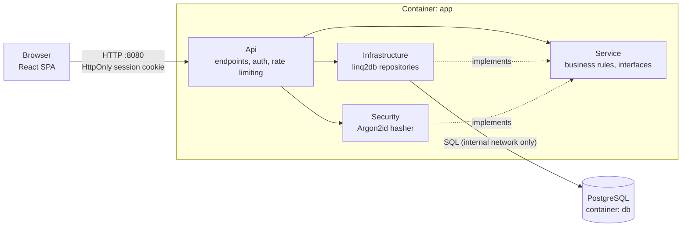

# Compulsory assignment: Kvist & Bjælke ApS – Secure Login Platform & Infrastructure

> **CDS Security & Infrastructure, CSe2025, 3rd semester (SEA - Syddansk Erhvervsakademi)**
>
> **Group:** `Davide Jorge and Lucas Santos` · **Repository:** `https://github.com/davide-jorge/sec-and-infra-compulsory-assignment.git` · **Submission:** 6 November 2026, 23:59 (Moodle)

---

## Table of contents

- [Part 1 – CDS.security](#part-1--cdssecurity)
    - [1. Description of the login platform](#1-description-of-the-login-platform)
    - [2. Implemented security features](#2-implemented-security-features)
    - [3. Alternatives considered](#3-alternatives-considered)
    - [4. Source code and how to run](#4-source-code-and-how-to-run)
- [Part 2 – CDS.infrastructure](#part-2--cdsinfrastructure)
    - [1. IP addressing plan](#1-ip-addressing-plan)
    - [2. Subnetting](#2-subnetting)
    - [3. Network diagram](#3-network-diagram)
    - [4. Ubuntu Server on VLAN 571](#4-ubuntu-server-on-vlan-571)
    - [5. Docker installation and deployment](#5-docker-installation-and-deployment)
    - [6. Client machine on VLAN 570](#6-client-machine-on-vlan-570)
    - [7. Client ↔ login platform communication](#7-client--login-platform-communication)
    - [8. Challenges and solutions](#8-challenges-and-solutions)
    - [9. VLANs, routing and firewall explained](#9-vlans-routing-and-firewall-explained)
- [Final reflection](#final-reflection)

---

# Part 1 – CDS.security

## 1. Description of the login platform

The platform is a web application where users authenticate with a **username and password** and, once logged in, see a user table whose available actions depend on the user's **role**.

| Role | Permissions |
|---|---|
| `user` | Read the list of users |
| `superuser` | Create, read, update and delete **users** |
| `admin` | Create, read, update and delete **users, superusers and admins** |

**Assumptions we made where the assignment is open:**
- All authenticated roles may *read* the full user list (the `user` role exists to read "users in a table").
- A `superuser` can only manage accounts with role `user`, and can never promote anyone to `superuser` or `admin`.
- There is no self-registration; the first admin is seeded from an environment variable.

### Technology stack

| Layer | Choice |
|---|---|
| Backend | .NET 10 (C#), ASP.NET Core minimal APIs |
| Data access | linq2db + Npgsql, PostgreSQL 17 (production) |
| API docs | OpenAPI + Swagger UI (Development only) |
| Password hashing | **Argon2id** (`Konscious.Security.Cryptography.Argon2`) |
| Frontend | Bun, React, React Router, Tailwind + daisyUI |
| Packaging | Multi-stage Dockerfile, Docker Compose |
| IDE | JetBrains Rider |

### Architecture

**Dependency direction:** `Service` has no dependency on any other project. `Infrastructure` and `Security` implement interfaces *defined in* `Service`, and `Api` wires everything together via dependency injection. This keeps the authorization rules testable without a database or a web server, and lets us replace the hashing algorithm or database without touching the business logic.

The React app is built by Bun and served as static files by ASP.NET Core, so the whole solution is **one container on one port** (no CORS configuration needed).
