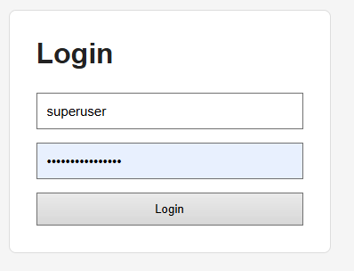
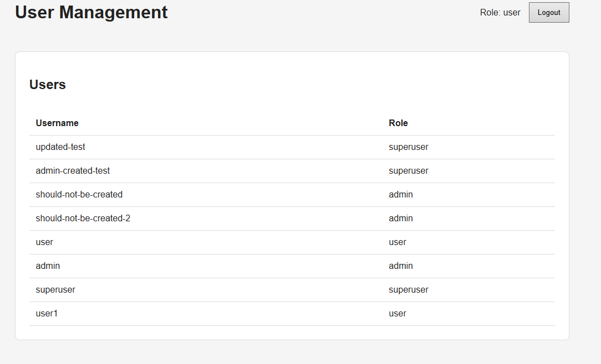
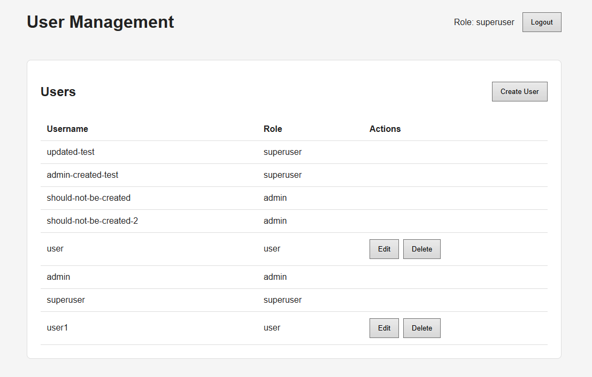
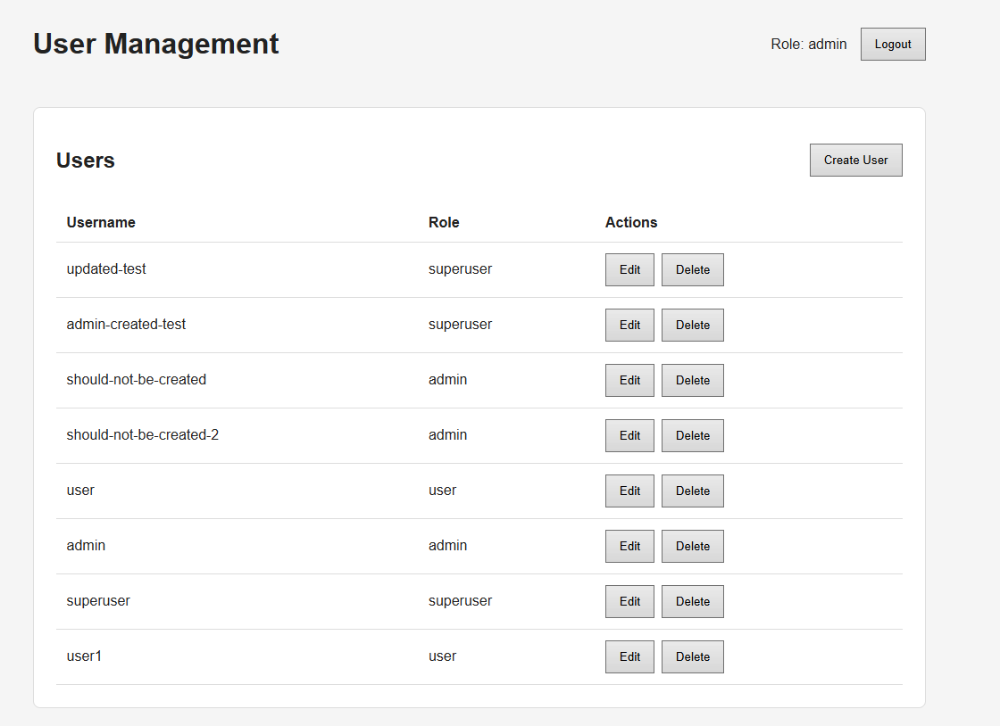
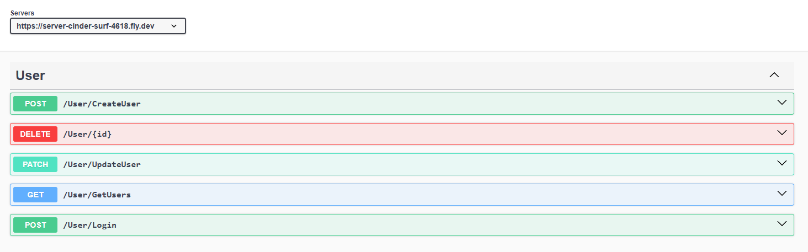
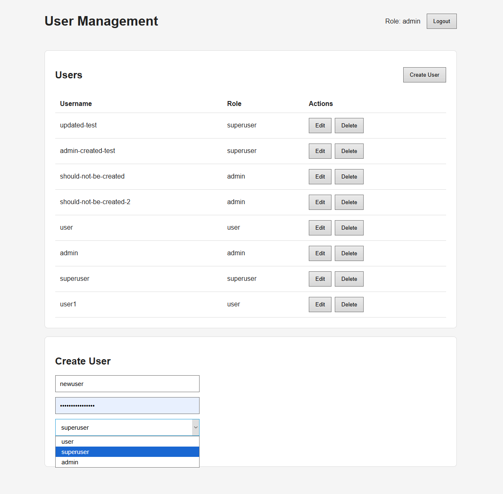
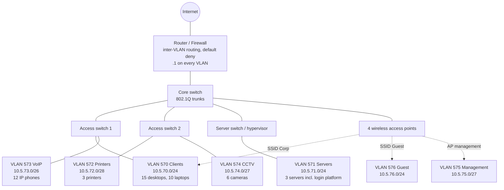

# Kvist & Bjælke ApS – Secure Login Platform & Infrastructure

> **CDS Security & Infrastructure, CSe2025, 3rd semester (SEA - Syddansk Erhvervsakademi)**
>
> **Group:** Davide Jorge · Lucas Santos

The report has two parts, **CDS.security** (the login platform) and **CDS.infrastructure** (network design and hosting), followed by a final reflection.

## Contents

- [Part 1 – CDS.security](#part-1--cdssecurity)
- [Part 2 – CDS.infrastructure](#part-2--cdsinfrastructure)
- [Final reflection](#final-reflection)

---

# Part 1 – CDS.security

## 1. The login platform

The platform is a web application where users authenticate with a **username and password** and, once logged in, see a user table whose available actions depend on the user's **role**.

| Role | Permissions |
|---|---|
| `user` | Read the list of users |
| `superuser` | Create, read, update and delete **users** |
| `admin` | Create, read, update and delete **users, superusers and admins** |

### Stack

| Layer | Technology |
|---|---|
| API | ASP.NET Core on .NET 10, controller at `/User` |
| Data access | linq2db with Npgsql, PostgreSQL |
| Password hashing | Argon2id (`Konscious.Security.Cryptography.Argon2`) |
| Authentication | JWT bearer token (HMAC-SHA256, 60 minutes) |
| Frontend | Bun and React 19, in its own container |
| Packaging | One Dockerfile each for `server/` and `client/`, plus `compose.yaml` |

### Repository layout

```text
client/                 Bun/React application
server/Api/             ASP.NET Core API and configuration
server/Service/         User operations, DTOs, hashing, JWT services
server/Infrastructure/  User model and linq2db connection
screenshots/            Screenshots (application and infrastructure evidence)
compose.yaml            Container configuration for the server VM
```

### API

| Endpoint | Access | Behavior |
|---|---|---|
| `POST /User/Login` | Public | Checks credentials and returns a JWT |
| `GET /User/GetUsers` | Authenticated | Lists users |
| `POST /User/CreateUser` | `superuser`, `admin` | Creates a user |
| `PATCH /User/UpdateUser` | `superuser`, `admin` | Updates username, password and role |
| `DELETE /User/{id}` | `superuser`, `admin` | Deletes a user |

A superuser can only manage accounts with the role `user`. An admin can manage every role. The restrictions are enforced **on the server**, both in the controller's authorization attributes and in the service logic. The buttons the frontend hides are only a convenience.

## Screenshots

| Login | User table (user) |
|---|---|
|  |  |

| User table (superuser) | User table (admin) |
|---|---|
|  |  |

| Swagger UI | Password hashes |
|---|---|
|  |  |

| Create user |
|---|
|  |

## 2. Security features

### Password storage: Argon2id

- Passwords are never stored in plaintext. Only the Argon2id hash is saved, and user responses never include `PasswordHash`.
- Parameters: 16-byte random salt per password, **64 MiB memory, 3 iterations, parallelism 4**, 32-byte hash. This matches the second parameter set recommended in RFC 9106.
- Stored format: `Base64(hash).Base64(salt)`. This is not the standard `$argon2id$...` string, so the parameters are not stored with the hash.
- Verification compares hashes with `CryptographicOperations.FixedTimeEquals` (constant time).

**Why Argon2id:** it is memory-hard, so cracking it on GPUs or ASICs is much more expensive than for fast hashes such as SHA-256. The *id* variant also resists side-channel attacks.

### Authentication: JWT

- A successful login returns a JWT signed with HMAC-SHA256 that expires after 60 minutes.
- The signing secret is mandatory configuration (`JwtSecret`) and is not stored in source control. Issuer and audience come from `server/Api/appsettings.json`.
- The login response is identical for an unknown username and a wrong password, so the message does not reveal which usernames exist.
- The frontend keeps the token in `sessionStorage` and sends it in the `Authorization` header.

## 3. Limitations

These are known gaps in the current implementation.

| Area | Current state | What we would add |
|---|---|---|
| Token storage | `sessionStorage` is readable by JavaScript, so an XSS bug could steal the token | HttpOnly, SameSite cookie, or a short-lived token with a refresh mechanism |
| Brute force | No rate limiting and no account lockout | Rate limiter on login and temporary lockout |
| User enumeration | Same message for both failures, but no dummy-hash check for unknown users, so timing can still differ | Verify against a dummy hash when the user does not exist |
| Last admin / self-delete | Self-deletion and deleting or demoting the last admin are **not** prevented | Add both checks to the service layer |
| CORS | Permissive | Allow only the client origin |
| Transport | Plain HTTP in the lab, so the token travels unencrypted | TLS through a reverse proxy |
| Other | No security headers, no antiforgery (not needed for bearer tokens), no rehash when parameters change, no admin seeding, no tests | Add as needed |

## 4. Alternatives considered

| Topic | Chosen | Alternatives | Reason |
|---|---|---|---|
| Password hashing | Argon2id | bcrypt, scrypt, PBKDF2, salted SHA-256 | Argon2id is memory-hard and the current recommendation. bcrypt is a reasonable fallback. PBKDF2 is cheap on GPUs, and plain SHA-256 is far too fast. |
| Authentication | JWT bearer token | Server-side session with HttpOnly cookie, ASP.NET Core Identity, OIDC | JWT is stateless and fits a separate React client. A cookie is safer against XSS but needs CSRF protection. Identity and OIDC are more than the assignment needs. |
| Token storage | `sessionStorage` | `localStorage`, HttpOnly cookie | `sessionStorage` is cleared when the tab closes, but it is still readable by scripts. |
| Data access | linq2db | EF Core, Dapper | Generates parameterized SQL, so there is no string-built SQL and no injection through user input. |

## 5. Source code and local build

The source code is in this repository.

```bash
dotnet build sec-and-infra-compulsory-assignment.slnx
```

The API needs the `JwtSecret` setting (for local development use .NET user-secrets or an environment variable) and a PostgreSQL database with the users table, configured through `ConnectionStrings__DefaultConnection`.

---

# Part 2 – CDS.infrastructure

## 1. IP addressing plan

Convention: the third octet is the last two digits of the VLAN ID, which matches the given VLANs 570 and 571. All VLANs sit inside `10.5.0.0/16`. The default gateway of every VLAN is `.1`, held by the router/firewall that routes between VLANs.

| VLAN | Purpose | Network | Mask | Gateway | Usable hosts | Devices | Addressing |
|---|---|---|---|---|---|---|---|
| 570 | Clients | 10.5.70.0/24 | 255.255.255.0 | 10.5.70.1 | 254 | 15 desktops, 10 laptops, corporate Wi-Fi | DHCP |
| 571 | Servers | 10.5.71.0/24 | 255.255.255.0 | 10.5.71.1 | 254 | 3 servers | Static |
| 572 | Printers | 10.5.72.0/28 | 255.255.255.240 | 10.5.72.1 | 14 | 3 printers | Static |
| 573 | VoIP | 10.5.73.0/26 | 255.255.255.192 | 10.5.73.1 | 62 | 12 IP phones | DHCP |
| 574 | CCTV | 10.5.74.0/27 | 255.255.255.224 | 10.5.74.1 | 30 | 6 cameras | Static |
| 575 | Management | 10.5.75.0/27 | 255.255.255.224 | 10.5.75.1 | 30 | Switches, 4 access points, firewall | Static |
| 576 | Guest | 10.5.76.0/24 | 255.255.255.0 | 10.5.76.1 | 254 | Visitors' phones and laptops | DHCP, short leases |

VLANs 577–599 are left free for future needs.

**Why segment:**

- **Servers apart from clients:** clients only get the ports they need, so a compromised laptop cannot reach everything on the servers.
- **Guests isolated:** internet only, no route to internal VLANs.
- **Printers, phones, cameras:** low-trust devices with different traffic. Cameras can be denied internet access.
- **Management separate:** switch and access point admin interfaces are not reachable from user networks.
- **In general:** smaller broadcast domains, easier troubleshooting and a smaller impact if one segment is compromised.

**Static vs. DHCP:** static addresses for devices others depend on (servers, printers, cameras, network equipment). DHCP for devices that come and go (clients, phones, guests).

**Proposed firewall policy (default deny):** clients reach the application on the server VLAN only on TCP 8000–8100. Clients reach printers on the print ports. Guests reach the internet only. Everything else between VLANs is blocked. In the lab, the school's firewall already allows VLAN 570 → VLAN 571 on TCP 8000–8100.

## 2. Subnetting

| Network | Mask | Calculation | Usable hosts | Devices now | Headroom |
|---|---|---|---|---|---|
| 10.5.72.0/28 (printers) | 255.255.255.240 | 2⁴ = 16, minus network and broadcast | **14** | 3 + gateway | about 3.5× |
| 10.5.73.0/26 (phones) | 255.255.255.192 | 2⁶ = 64, minus 2 | **62** | 12 + gateway | about 4.8× |
| 10.5.70.0/24 (clients) | 255.255.255.0 | 2⁸ = 256, minus 2 | **254** | 25 + gateway | about 10× |

The rule is to pick the smallest subnet that fits today's devices with room to grow 2–4×. The client network is a full /24 because laptops, phones and tablets multiply fastest. The printer and phone networks are small, and the address blocks after them are free, so they can be widened later without renumbering.

## 3. Network diagram



This diagram is the proposal for the whole company. Only the server on VLAN 571 and the client on VLAN 570 are built in the virtual environment.

## 4. Server on VLAN 571

A virtual machine with Ubuntu Server, its network adapter attached to VLAN 571.

| Setting | Value |
|---|---|
| Operating system | Ubuntu Server |
| Network | VLAN 571, network `10.5.71.0/24` |
| Address | Static address in `10.5.71.0/24` |
| Gateway | `10.5.71.1` |

Static address with netplan. The address below is an example, use the one you were assigned, and find the interface name with `ip a`:

```yaml
network:
  version: 2
  ethernets:
    ens18:
      dhcp4: false
      addresses: [10.5.71.20/24]
      routes:
        - to: default
          via: 10.5.71.1
      nameservers:
        addresses: [1.1.1.1, 9.9.9.9]
```

```bash
sudo chmod 600 /etc/netplan/*.yaml
sudo netplan try        # rolls back automatically if connectivity is lost
sudo netplan apply
```

## 5. Docker and deployment

Docker is installed from Docker's official apt repository:

```bash
sudo apt update && sudo apt install -y ca-certificates curl
sudo install -m 0755 -d /etc/apt/keyrings
sudo curl -fsSL https://download.docker.com/linux/ubuntu/gpg -o /etc/apt/keyrings/docker.asc
sudo chmod a+r /etc/apt/keyrings/docker.asc
echo "deb [arch=$(dpkg --print-architecture) signed-by=/etc/apt/keyrings/docker.asc] https://download.docker.com/linux/ubuntu $(. /etc/os-release && echo "${UBUNTU_CODENAME:-$VERSION_CODENAME}") stable" | sudo tee /etc/apt/sources.list.d/docker.list > /dev/null
sudo apt update
sudo apt install -y docker-ce docker-ce-cli containerd.io docker-buildx-plugin docker-compose-plugin
sudo usermod -aG docker $USER && newgrp docker
docker run --rm hello-world
```

### Selected ports

| Service | Host port | Container port |
|---|---|---|
| Client (React) | **8080** | client container |
| API | **8081** | 4000 |
| PostgreSQL | not published | 5432 |

Both published ports are inside the permitted range 8000–8100. The database has no published port, so only the API container can reach it.

### Configuration

The deployment uses `compose.yaml`, which starts three containers: `db` (PostgreSQL), `api` and `client`. It needs three values in a `.env` file next to it (never commit this file):

| Variable | Meaning |
|---|---|
| `DB_PASSWORD` | PostgreSQL password |
| `JWT_SECRET` | Long random signing secret, for example `openssl rand -base64 48` |
| `SERVER_IP` | The server VM's address on VLAN 571 |

The database is created from `db/init.sql` (schema and first admin account, exported from the development database with `pg_dump`). The script runs only when the data volume is empty.

```bash
git clone <repository-url> app && cd app
nano .env
docker compose up -d --build
docker compose ps
```

### Two things that must be right for the client machine to work

1. **The API address is a build argument.** The frontend must not use the hard-coded Fly.io address in `client/src/App.tsx`. It must take its API address from the `API_URL` build argument (`http://<SERVER_IP>:8081`). Otherwise the client machine would talk to the internet deployment and not to the server on VLAN 571.
2. **The address must be the server's IP, not `localhost`.** The React code runs in the browser on the client machine, so the browser connects to the API directly. This is also why the API needs CORS: the page is served from port 8080 and calls port 8081.

## 6. Client on VLAN 570

A second virtual machine with a browser (for example Ubuntu Desktop), its network adapter attached to VLAN 570, address in `10.5.70.0/24` with gateway `10.5.70.1`.

## 7. Verification

Each test and its expected result. Screenshots are stored in `screenshots/` under the name shown.

**Server (VLAN 571)**

| Test | Command | Expected result | Screenshot |
|---|---|---|---|
| Ubuntu Server installed | `lsb_release -a` | Ubuntu Server release | `server-os.png` |
| Correct IP configuration | `ip a`, `ip route` | Address in `10.5.71.0/24`, default route via `10.5.71.1` | `server-ip.png` |
| Docker working | `docker --version`, `docker run --rm hello-world` | Version shown, hello-world succeeds | `docker-installed.png` |
| Platform in containers | `docker compose ps` | `db`, `api`, `client` running | `docker-ps.png` |
| Reachable on selected ports | `curl -I http://localhost:8080` and `ss -tlnp \| grep -E '8080\|8081'` | HTTP response, both ports listening | `server-ports.png` |

**Client (VLAN 570)**

| Test | Command / action | Expected result | Screenshot |
|---|---|---|---|
| Correct IP configuration | `ip a`, `ip route` | Address in `10.5.70.0/24`, default route via `10.5.70.1` | `client-ip.png` |
| Gateway reachable | `ping -c3 10.5.70.1` | Replies | `client-gateway.png` |
| Ports open through firewall | `nc -zv <server-ip> 8080` and `nc -zv <server-ip> 8081` | Both succeed | `client-ports.png` |
| Platform usable | Browser to `http://<server-ip>:8080`, log in as each role | Login works; each role sees its own permissions | `client-login.png`, `client-roles.png` |
| Firewall blocks other ports | `nc -zv -w3 <server-ip> 22` | Times out | `client-blocked.png` |

A `ping` to the server may fail. The firewall only allows TCP 8000–8100, so ICMP is dropped. This is expected behavior, not a fault.

## 8. Challenges and solutions

Problems found when moving the application from its development setup to the server VM:

| Challenge | Cause | Solution |
|---|---|---|
| The original `compose.yaml` could not start the system | It used a SQLite connection string while the API uses PostgreSQL, had no database service or schema, and did not set `JwtSecret` | New `compose.yaml` with a PostgreSQL service, `init.sql`, a health check, and `JWT_SECRET` and the connection string passed as environment variables |
| Client would use the wrong backend | The frontend calls a hard-coded Fly.io URL | The API address is a build argument pointing to the server on VLAN 571 |
| Services not reachable from another VLAN | Ports were bound to loopback (`3500`, `3501`) and outside the permitted range | Publish on `8080` and `8081`, which are inside 8000–8100 and open in the firewall |
| Application would not start before the database was ready | Container start order | `depends_on` with `condition: service_healthy` and a `pg_isready` health check |

## 9. VLANs, routing and the firewall

**Why VLAN 570 and VLAN 571 are separate networks.** Clients and servers have different trust levels and traffic. Separate VLANs give separate broadcast domains and let a different security policy apply to each. A compromised workstation should not sit on the same Layer 2 segment as the servers.

**Why communication between VLANs needs routing.** A VLAN is an isolated Layer 2 broadcast domain with its own IP subnet. A host only talks directly to addresses in its own subnet and sends everything else to its default gateway. A Layer 3 device (router or firewall) must therefore forward packets between `10.5.70.0/24` and `10.5.71.0/24`.

**The role of the firewall.** All traffic between VLANs passes through the firewall, which decides which source may reach which destination on which port. It is stateful, so replies to allowed connections pass automatically, and with default deny anything not explicitly allowed is dropped.

**Why allow only specific ports.** Least privilege. The clients only need the web application on TCP 8000–8100. Blocking everything else, such as SSH or database ports, reduces the attack surface: even a compromised client cannot reach other services on the server.

---

# Final reflection

**Security and infrastructure are connected.** The application protects passwords (Argon2id) and functions (roles), and the infrastructure protects the application (segmentation, a firewall that allows only the application ports, and a database that is not exposed). Each layer covers a weakness in the other. For example, a strong hash does not help if the token travels over plain HTTP, and a strict firewall does not help against a weak application.

**Technical challenges.** The main one was that an application that worked in development did not work on the target infrastructure. The Compose file did not match the database the API uses, secrets were missing, the frontend pointed at an external URL, and the ports did not match what the firewall permits (see the challenges table).

**What we learned about deploying an application.** Configuration must come from the environment and not from code (connection string, `JwtSecret`, API address). Container start order matters, and a published port is part of the network design. A browser-based frontend talks to the API from the *user's* machine, so "localhost" in its configuration does not mean the server.

**What we would do differently in a real company.**

- Put a reverse proxy with TLS in front of the platform, and use HTTPS everywhere.
- Close the limitations listed in Part 1: rate limiting and lockout, protection of the last admin, restricted CORS, and a safer token storage.
- Add automated tests and a CI/CD pipeline instead of manual deployment.
- Keep secrets in a secret manager, back up the database, and add logging and monitoring.
- Use a redundant firewall and core switch, and keep the configuration in code.
